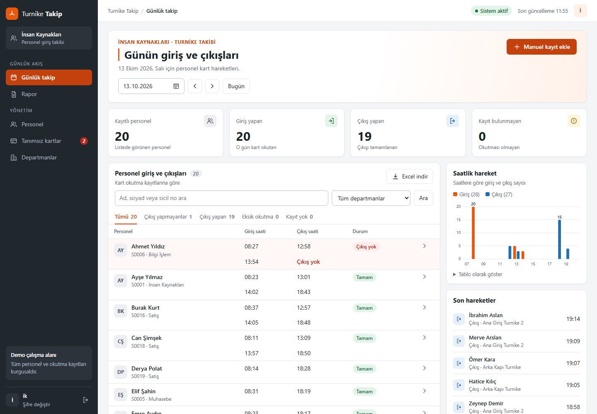
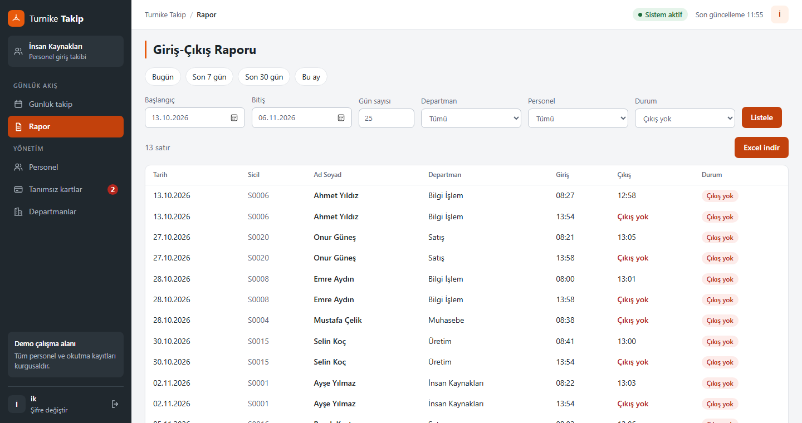
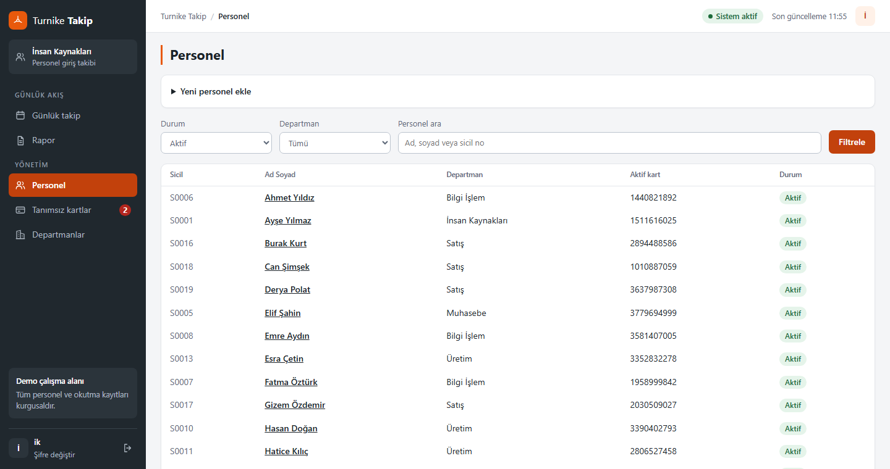
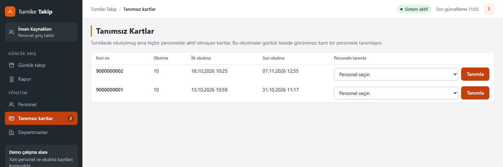
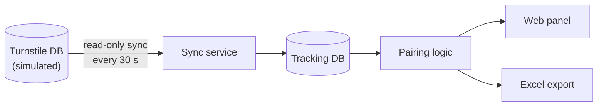

# Turnike Takip

**English** · [Türkçe](README.tr.md)

A web-based attendance tracker for HR teams. It imports employee card scans from a turnstile system's database, pairs them into entries and exits, and lets HR review each day and export date-range reports to Excel.

Built as an internship project. This repository is a **demo**: it runs against a local database that simulates the turnstile system, and all employees and scans are fictional.



## Features

- **Daily list:** every employee's entry and exit times for a chosen day, with filters by department, name and status
- **Missing scans made visible:** an entry with no matching exit is flagged instead of being guessed
- **Daily overview:** summary cards, an hourly entry and exit chart, and the latest movements
- **Manual records:** HR can add an entry or exit when a card could not be scanned; these are labeled and can be removed
- **Excel reports:** any date range or "last N days" (up to 366), filterable by department, employee and status
- **Employee and card management:** add, edit or deactivate employees and assign or close cards; history is kept
- **Unknown cards:** scans from unassigned cards are listed separately and can be assigned to an employee, along with their past scans
- **Background sync:** new scans are imported every 30 seconds; the source database is only read
- **Security:** session-based login with scrypt password hashing, CSRF tokens on every form, login attempt limiting and in-app password change

| Report | Employee management | Unknown cards |
|---|---|---|
|  |  |  |

## How it works



The app never writes to the turnstile database. Only one file, [`sql/kaynak_sorgu.sql`](sql/kaynak_sorgu.sql), knows the source table's shape, so pointing the app at a different system means changing that query and the connection string.

| Status | Meaning |
|---|---|
| Tamam | Every entry has an exit |
| İçeride | Today's last scan is an entry, so the person may still be inside |
| Çıkış yok | A past day ended with an entry and no exit |
| Eksik okutma | A scan is missing mid-day, or a scan has no direction |
| Kayıt yok | No scans that day |

### Design decisions

- **Incremental, resumable sync.** Each run continues from the highest imported source ID and commits in batches. A `UNIQUE` constraint on that ID makes double imports impossible.
- **Scans store the employee at import time.** If a card is later given to someone else, earlier records stay with the original owner. A previously closed card does not pass its old scans to its new owner.
- **Pairing logic is free of I/O.** [`app/hesaplama.py`](app/hesaplama.py) takes a list and returns a result, so it is tested without a database.
- **The database enforces the rules.** Uniqueness is guaranteed by constraints, including a filtered index that allows a card to be active for only one person at a time while still being reusable later.
- **Turkish text rules are built in.** SQLite only folds ASCII case, so the app registers its own collation and search function. Searching `ibrahim` finds `İbrahim`, and names sort in Turkish alphabetical order.
- **Untrusted input is handled at each boundary.** SQL is parameterized, templates are auto-escaped, and text cells in Excel are written as strings so a name cannot run as a formula.

## Tech stack

Python · FastAPI · SQLite · Jinja2 · openpyxl · pytest

## Running it locally

The only requirement is Python 3.10 or newer (tested on 3.14 on Windows). No database server is needed.

On Windows, run `baslat.bat`. On first launch it installs the dependencies. On other systems:

```bash
python -m venv .venv
.venv/bin/python -m pip install -r requirements.txt
.venv/bin/python -m uvicorn app.main:app --host 127.0.0.1 --port 8000
```

Open <http://127.0.0.1:8000> and sign in with `ik` / `demo`. On first launch the app creates its SQLite files in `data/` and loads four weeks of fictional sample data. The `demo` password exists for local evaluation only.

To read scans from a real SQL Server instead of the demo file, install `pyodbc`, set `KAYNAK_ODBC` in `.env` (see `.env.example`) and adapt `sql/kaynak_sorgu.sql`.

## Tests

```powershell
.\.venv\Scripts\python.exe -m pytest tests -q
```

The tests cover scan pairing, Turkish text rules, Excel output, login, and the employee, card and report flows end to end. They run against temporary databases.

## Project structure

```
app/
  senkron.py      Sync from the source database
  hesaplama.py    Pairs scans into entries and exits
  gunluk.py       Daily list query
  rapor.py        Date-range report and Excel export
  yonetim.py      Employee, card and department pages
  guvenlik.py     Password hashing
  db.py           SQLite connection and Turkish text rules
  main.py         App setup, login, daily page
scripts/          Setup, sample data, user management
sql/              Schemas and the source query
tests/            Automated tests
```

Code identifiers and the interface are in Turkish, since the tool was built for a Turkish HR team.

## Known limitations

- Scans are grouped by calendar day, so night shifts that cross midnight are split across two days.
- Login attempt limits are kept in memory, so they reset on restart and assume a single server process.
- A real deployment with employee data would need a privacy review. The public demo mode (`CANLI_DEMO=1`) is only for fictional data: it resets the data periodically and disables password changes.
