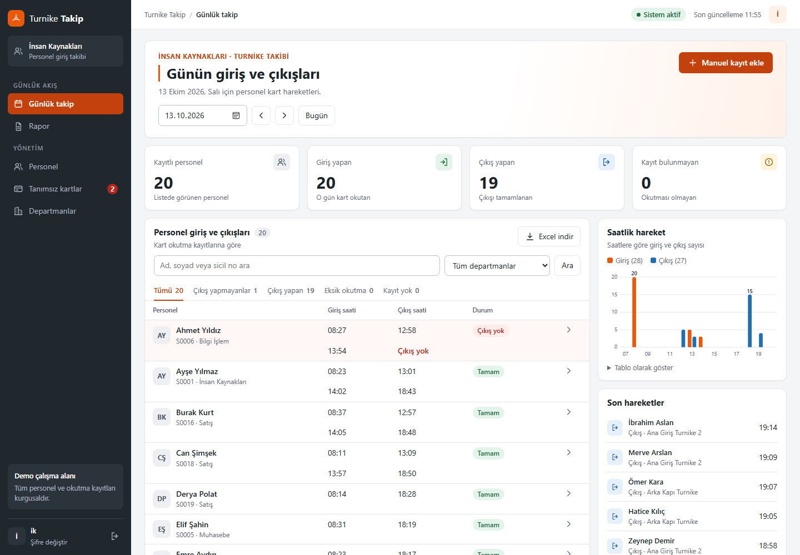
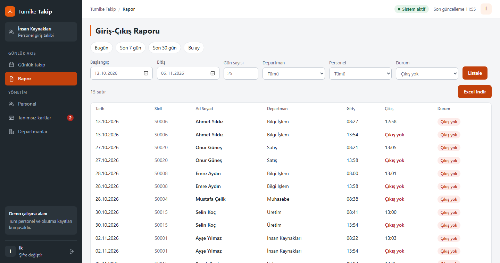
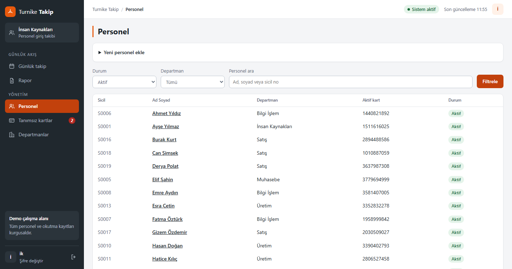
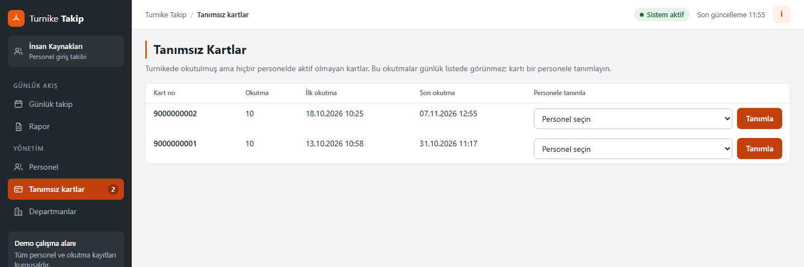
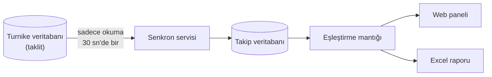

# Turnike Takip

[English](README.md) · **Türkçe**

İnsan kaynakları ekipleri için web tabanlı giriş-çıkış takip uygulaması. Turnike sisteminin veritabanındaki kart okutmalarını aktarır, bunları giriş ve çıkış olarak eşleştirir; İK'nın her günü incelemesini ve istediği tarih aralığı için Excel raporu almasını sağlar.

Staj projesi olarak geliştirildi. Bu depo bir **demodur**: turnike sistemini taklit eden yerel bir veritabanıyla çalışır, tüm personel ve okutma kayıtları kurgusaldır.



## Özellikler

- **Günlük liste:** seçilen gün için her personelin giriş ve çıkış saatleri; departman, isim ve duruma göre filtre
- **Eksik okutmalar görünür:** çıkışı olmayan giriş tahmin edilmez, işaretlenir
- **Günlük özet:** özet kartları, saatlik giriş-çıkış grafiği ve son hareketler
- **Manuel kayıt:** kart okutulamadığında İK giriş veya çıkış ekleyebilir; bu kayıtlar işaretlenir ve silinebilir
- **Excel raporu:** istenen tarih aralığı veya "son N gün" (en fazla 366); departman, personel ve duruma göre filtre
- **Personel ve kart yönetimi:** personel ekleme, düzenleme, pasife alma; kart tanımlama ve kapatma; geçmiş kayıtlar korunur
- **Tanımsız kartlar:** sahibi olmayan kartların okutmaları ayrı listelenir, kart bir personele geçmiş okutmalarıyla birlikte tanımlanabilir
- **Arka planda senkron:** yeni okutmalar 30 saniyede bir aktarılır; kaynak veritabanından yalnızca okunur
- **Güvenlik:** oturum tabanlı giriş, scrypt ile şifre özetleme, her formda CSRF jetonu, giriş denemesi sınırı ve panelden şifre değiştirme

| Rapor | Personel yönetimi | Tanımsız kartlar |
|---|---|---|
|  |  |  |

## Nasıl çalışır



Uygulama turnike veritabanına hiçbir zaman yazmaz. Kaynak tablonun yapısını yalnızca [`sql/kaynak_sorgu.sql`](sql/kaynak_sorgu.sql) dosyası bilir; başka bir sisteme bağlanmak için bu sorguyu ve bağlantı bilgisini değiştirmek yeterlidir.

| Durum | Anlamı |
|---|---|
| Tamam | Her girişin çıkışı var |
| İçeride | Bugünün son okutması giriş, kişi hâlâ içeride olabilir |
| Çıkış yok | Geçmiş bir gün çıkışsız bir girişle bitmiş |
| Eksik okutma | Gün ortasında okutma eksik veya okutmanın yönü bilinmiyor |
| Kayıt yok | O gün okutma yok |

### Tasarım kararları

- **Kaldığı yerden devam eden senkron.** Her çalışma, aktarılmış en büyük kaynak numarasından devam eder ve partiler halinde kaydeder. Bu numaradaki `UNIQUE` kısıtı aynı kaydın iki kez aktarılmasını imkânsız kılar.
- **Okutma, aktarıldığı andaki personele yazılır.** Kart sonradan başkasına verilirse eski kayıtlar ilk sahibinde kalır. Daha önce kapatılmış bir kart, eski okutmalarını yeni sahibine aktarmaz.
- **Eşleştirme mantığı dış dünyadan bağımsızdır.** [`app/hesaplama.py`](app/hesaplama.py) liste alıp sonuç döndürür, bu yüzden veritabanı olmadan test edilir.
- **Kuralları veritabanı garanti eder.** Benzersizlik kısıtlarla sağlanır; filtreli bir index, bir kartın aynı anda tek kişide aktif olmasını sağlarken sonradan yeniden kullanılmasına izin verir.
- **Türkçe metin kuralları yerleşiktir.** SQLite yalnızca ASCII harflerde büyük/küçük ayrımını yok sayar; bu yüzden uygulama kendi sıralama kuralını ve arama fonksiyonunu tanımlar. `ibrahim` araması `İbrahim`i bulur, isimler Türk alfabesine göre sıralanır.
- **Güvenilmeyen girdi her sınırda ele alınır.** SQL sorguları parametrelidir, şablonlar otomatik kaçış yapar, Excel'de metin hücreleri düz metin yazılır; böylece bir isim formül olarak çalışamaz.

## Teknolojiler

Python · FastAPI · SQLite · Jinja2 · openpyxl · pytest

## Yerelde çalıştırma

Tek gereksinim Python 3.10 veya üzeri (Windows'ta 3.14 ile test edildi). Veritabanı sunucusu gerekmez.

Windows'ta `baslat.bat` dosyasını çalıştırın; ilk açılışta paketleri kendisi kurar. Diğer sistemlerde:

```bash
python -m venv .venv
.venv/bin/python -m pip install -r requirements.txt
.venv/bin/python -m uvicorn app.main:app --host 127.0.0.1 --port 8000
```

<http://127.0.0.1:8000> adresini açıp `ik` / `demo` ile giriş yapın. Uygulama ilk açılışta SQLite dosyalarını `data/` klasöründe oluşturur ve dört haftalık kurgusal örnek veri yükler. `demo` şifresi yalnızca yerel deneme içindir.

Okutmaları demo dosyası yerine gerçek bir SQL Server'dan okumak için `pyodbc` kurun, `.env` dosyasında `KAYNAK_ODBC` değerini verin (`.env.example` dosyasına bakın) ve `sql/kaynak_sorgu.sql` dosyasını uyarlayın.

## Testler

```powershell
.\.venv\Scripts\python.exe -m pytest tests -q
```

Testler okutma eşleştirmeyi, Türkçe metin kurallarını, Excel çıktısını, girişi ve personel, kart ve rapor akışlarını baştan sona kapsar; geçici veritabanlarında çalışır.

## Proje yapısı

```
app/
  senkron.py      Kaynak veritabanından aktarım
  hesaplama.py    Okutmaları giriş-çıkış olarak eşleştirir
  gunluk.py       Günlük liste sorgusu
  rapor.py        Tarih aralığı raporu ve Excel çıktısı
  yonetim.py      Personel, kart ve departman sayfaları
  guvenlik.py     Şifre özetleme
  db.py           SQLite bağlantısı ve Türkçe metin kuralları
  main.py         Uygulama kurulumu, giriş, günlük sayfa
scripts/          Kurulum, örnek veri, kullanıcı yönetimi
sql/              Şemalar ve kaynak sorgusu
tests/            Otomatik testler
```

## Bilinen sınırlamalar

- Okutmalar takvim gününe göre gruplanır; gece yarısını geçen vardiyalar iki güne bölünür.
- Giriş denemesi sınırları bellekte tutulur; yeniden başlatınca sıfırlanır ve tek sunucu işlemi varsayar.
- Gerçek personel verisiyle kullanım için kişisel veri incelemesi gerekir. Herkese açık demo modu (`CANLI_DEMO=1`) yalnızca kurgusal veri içindir: verileri düzenli sıfırlar ve şifre değiştirmeyi kapatır.
